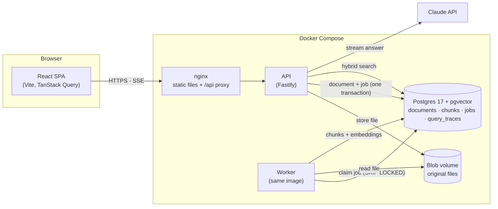
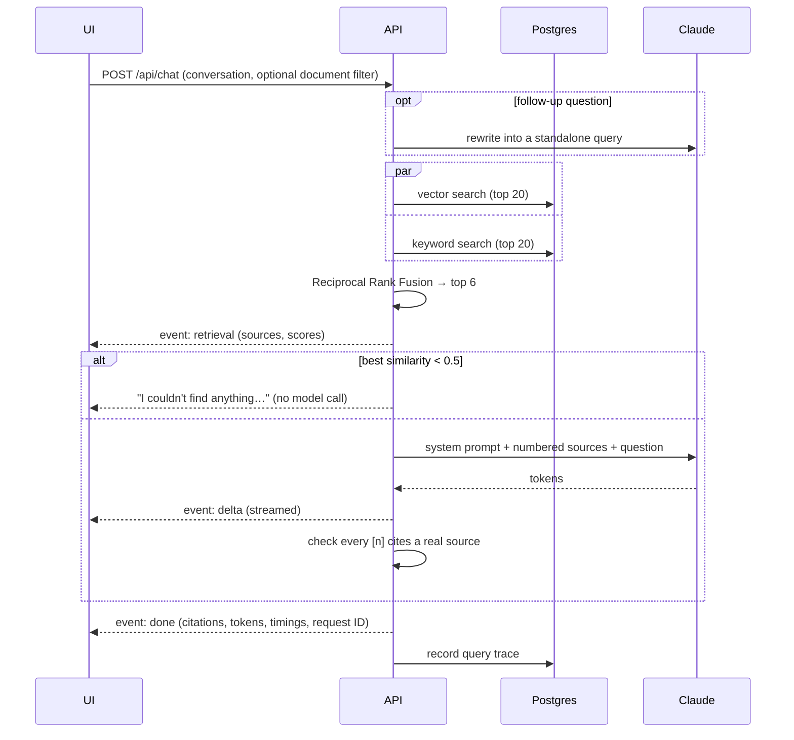

# DocChat

Chat with your documents. Upload PDFs, Markdown or text files and ask questions in plain English. Every answer comes only from your documents, cites the passages it used, and can be traced back to how it was retrieved.


**Features**

- **Grounded answers with citations.** Answers stream token by token. Each claim cites a numbered source chip that opens the exact passage.
- **Says when it doesn't know.** Off-topic questions are stopped before reaching the model. On-topic questions the documents can't answer get "I couldn't find that" rather than a guess.
- **Hybrid retrieval.** Semantic (vector) search and keyword search, merged with Reciprocal Rank Fusion.
- **Follow-up questions.** "Can I carry any of it over?" is rewritten into a standalone search query using the conversation.
- **Source inspector.** For any citation: the full passage with query terms highlighted, similarity score, vector and keyword rank, whether it was cited, and a per-stage timing breakdown.
- **Scope the chat** to selected documents.
- **Observability.** Every question is stored as a trace (outcome, scores, tokens, timings) and summarised at `/api/traces/stats`.
- **Evaluated.** A free retrieval eval and an LLM-graded answer-quality eval, with results committed in [`apps/api/evals/results/`](apps/api/evals/results/).

## Quick start

Requirements: Docker, and an [Anthropic API key](https://console.anthropic.com/) for answers.

```bash
cp .env.example .env              # set ANTHROPIC_API_KEY
docker compose up --build -d      # or: make up
```

Open **http://localhost:8080** and upload the files in [`sample-docs/`](sample-docs/) (a fictional company's handbook, product FAQ and a PDF runbook) to try it.

The first build takes a few minutes: the embedding model (~130 MB) is downloaded into the image so containers start without network access. Without an API key the app still runs: retrieval works and the chat shows the sources it would have sent to the model.

### Local development

Needs Node 24+ and pnpm (`corepack enable`).

```bash
pnpm install
make db       # Postgres in Docker + migrations
make dev      # API on :3000, worker, and web on :5173 with hot reload
```

### Checks

| Command                 | What it runs                                                                |
| ----------------------- | --------------------------------------------------------------------------- |
| `make check`            | Lint, type check, unit and integration tests (what CI runs)                 |
| `pnpm test`             | Unit tests (API and web), no Docker needed                                  |
| `pnpm test:integration` | Postgres adapter tests against a throwaway pgvector container               |
| `pnpm eval:retrieval`   | Retrieval quality report; free, needs Docker                                |
| `pnpm eval:answers`     | Answer quality graded by Claude; needs Docker and an API key (~$0.45 a run) |

## Architecture overview



<!-- TODO(you): one paragraph in your own words on the shape of the system and why. -->

**Uploading a document.** The API checks the file type from its content (not the client's Content-Type), stores it under its SHA-256 hash (so duplicate uploads are free), and inserts the document row and its ingestion job in one transaction. It returns at once. The worker claims the job, parses the file (per page for PDFs, per heading for Markdown), splits it into ~350-token chunks, embeds them locally with `bge-small-en-v1.5`, and replaces the document's chunks atomically, so retries never duplicate anything.

**Asking a question.**



### Repository layout

```
apps/api            Fastify API + ingestion worker
  src/domain        Pure logic: chunking, Markdown parsing, rank fusion, prompts
  src/services      Use cases: upload, ingest, retrieve, answer
  src/ports         Interfaces the services depend on
  src/adapters      Postgres, local disk, embedding model, Claude, PDF parsing
  src/routes        HTTP layer (thin: validate, call a service, respond)
  src/main.ts       Composition root for the API
  src/worker.ts     Composition root for the worker
  drizzle/          SQL migrations
  evals/            Retrieval and answer-quality evals, and their results
  test/             Unit tests (fakes) and integration tests (real Postgres)
apps/web            React + Vite frontend (features/documents, chat, inspect)
packages/shared     Zod schemas: the API contract used by both apps
sample-docs         Demo corpus
docs/               Screenshots and architecture decision records
```

### API

| Endpoint                         | Purpose                                                                                        |
| -------------------------------- | ---------------------------------------------------------------------------------------------- |
| `POST /api/documents`            | Upload a file (multipart `file`). 201 if new, 200 if an identical file exists.                 |
| `GET /api/documents`             | List documents with processing status and chunk counts                                         |
| `GET /api/documents/:id`         | One document                                                                                   |
| `DELETE /api/documents/:id`      | Delete a document, its chunks and its file                                                     |
| `POST /api/chat`                 | Ask a question; answer streamed as server-sent events (`retrieval`, `delta`, `done` / `error`) |
| `GET /api/traces?limit=20`       | Most recent question traces                                                                    |
| `GET /api/traces/stats?hours=24` | Outcome counts, answers without citations, p50/p95 latency, token totals                       |
| `GET /api/health`                | Liveness and database check                                                                    |

All request and response shapes are Zod schemas in [`packages/shared`](packages/shared/src/index.ts). Errors share one shape: `{ error: { code, message, requestId } }`.

### Configuration

Set in `.env` (see [`.env.example`](.env.example)). All values are validated at startup; the defaults are in [`apps/api/src/config.ts`](apps/api/src/config.ts).

| Variable                                            | Default                    |                                                             |
| --------------------------------------------------- | -------------------------- | ----------------------------------------------------------- |
| `ANTHROPIC_API_KEY`                                 | (unset)                    | Without it, retrieval works but answers are disabled        |
| `LLM_MODEL` / `LLM_EFFORT`                          | `claude-opus-5-5` / `low`  | Answer model and reasoning effort                           |
| `EMBEDDING_MODEL`                                   | `Xenova/bge-small-en-v1.5` | Local embedding model (384 dimensions)                      |
| `CHUNK_TARGET_TOKENS` / `CHUNK_OVERLAP_TOKENS`      | `350` / `50`               | Must stay under the embedding model's 512-token input limit |
| `RETRIEVAL_TOP_K` / `RETRIEVAL_MIN_SIMILARITY`      | `6` / `0.5`                | Sources sent to the model; relevance gate threshold         |
| `CHAT_HISTORY_TURNS`                                | `6`                        | Conversation turns sent with each question                  |
| `RATE_LIMIT_CHAT_PER_MIN` / `_UPLOAD_` / `_GLOBAL_` | `20` / `30` / `300`        | Per client IP                                               |
| `TRUST_PROXY`                                       | `loopback,uniquelocal`     | Proxies allowed to set `X-Forwarded-For`                    |
| `MAX_UPLOAD_MB`                                     | `20`                       |                                                             |

## Evaluation results

Both evals run against a fresh database with `sample-docs/` ingested by the production pipeline. Full reports, including every answer and the grader's reasoning: [`apps/api/evals/results/`](apps/api/evals/results/).

**Retrieval** (24 answerable questions, k = 6):

| Mode    | hit@1 | hit@3 | MRR   |
| ------- | ----- | ----- | ----- |
| Vector  | 92%   | 100%  | 0.958 |
| Keyword | 88%   | 100%  | 0.931 |
| Hybrid  | 92%   | 100%  | 0.958 |

**Answer quality** (Claude Opus 5.5 answering, Claude Opus 5.5 grading):

|                                                             | Result                                        |
| ----------------------------------------------------------- | --------------------------------------------- |
| Answerable: correct / faithful to sources / correctly cited | 24/24 · 24/24 · 24/24                         |
| Unanswerable: declined instead of answering                 | 6/6 (2 by the relevance gate, 4 by the model) |
| Hallucinated answers                                        | 0                                             |
| Latency p50 / p95                                           | 1.3 s / 2.1 s                                 |
| Cost of the run                                             | $0.43                                         |

<!-- TODO(you): your interpretation, including the caveats (easy test set, same-family grader, small sample). -->

## RAG / LLM approach and decisions

<!-- TODO(you): chunking, embedding model, vector DB, LLM, orchestration, prompt & context management, guardrails, quality, observability. See your notes. -->

## Key technical decisions

<!-- TODO(you): link to docs/adr/*. -->

## Engineering standards followed (and skipped)

<!-- TODO(you) -->

## Productionising on AWS / GCP / Azure / Cloudflare

<!-- TODO(you) -->

## How I used AI tools

<!-- TODO(you): CLAUDE.md is the conventions file the assistant follows. -->

## What I'd do differently with more time

<!-- TODO(you) -->

## Screenshots

| Source inspector                             | Scoped to one document                        |
| -------------------------------------------- | --------------------------------------------- |
|  |  |

| Dark mode                               | Mobile                                         |
| --------------------------------------- | ---------------------------------------------- |
|  |  |
